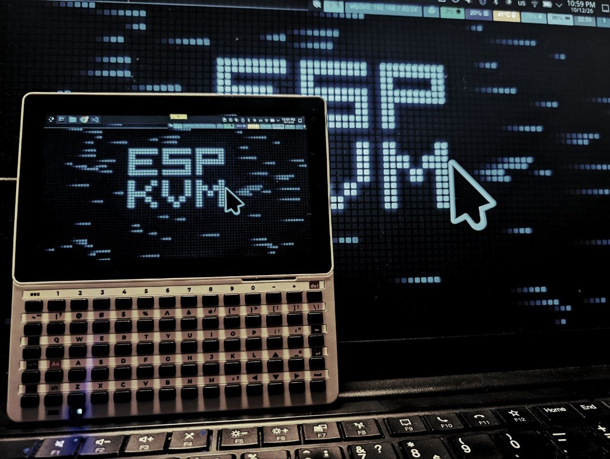

# ESP-KVM terminal

Firmware for the M5Stack Tab5 that shows an [ESP-KVM](https://github.com/espkvm/espkvm)
device's screen on the Tab5's display. The Tab5's touch screen and keyboard
control the target. No browser or computer is needed.



## Status

Early. It runs on my Tab5 against my own ESP-KVM devices.

Works on hardware:

- Wi-Fi through the Tab5's ESP32-C6: scan, pick a network, type the
  password. The Tab5 remembers it.
- Sign-in with user and password. On the first visit the device's CA is
  shown with its SHA-256 fingerprint and trusted only after you accept it.
- The picture: MJPEG from the device. The Tab5 draws everything that
  arrives, up to about 20 fps at 1280x720; over Wi-Fi the device usually
  sends 10 to 20.
- The menu and the notes over the picture, without flicker.
- Touch input to the target, the trackpad mode, two-finger scroll, and
  zoom with a pinch.
- The bar of extra keys, with Ctrl, Alt, Win and Shift held for the next key.
- Finding ESP-KVM devices on the network by mDNS (other HTTPS devices, such
  as routers, are left out).
- Reconnecting after the device or the network drops.
- Sleep: the screen goes dark and no picture is sent; a touch wakes it.
- Asking GitHub for the latest release of itself.
- Turning the screen over when the Tab5 is held upside down.
- Screen brightness from the menu and the TERMINAL screen.
- The battery level and switching off.
- The target's power, hard off, reset and Wake-on-LAN buttons, and
  Ctrl+Alt+Del.
- A USB keyboard and mouse in the Tab5's USB-A port.
- Tailscale: a device reached by its tailnet address, about 11 to 14 fps at
  720p on my network.

The device's video codec must be set to MJPEG. The P4 has no
H.264 decoder, and software decoding manages about 4 fps at 720p.

## Using it

- **Direct mode** (the default): the finger is the pointer. Tap = click,
  hold = right click, drag = left drag.
- **Trackpad mode** (in the menu): the finger moves the pointer like a
  laptop's touchpad. Tap = click, hold = right click, hold then move = drag.
- **Two fingers:** pinch to zoom in (up to 8x), drag to move around the
  zoomed picture. Not zoomed, a two-finger drag scrolls like a mouse wheel.
  The chip in the top right corner shows the zoom; tap it to see the whole
  picture again.
- **KEYS** in the menu shows a bar with Esc, F1-F12, Tab, the arrows, the
  page keys and Enter. Ctrl, Alt, Win and Shift stay lit and are held for
  the next key.
- **A USB keyboard and mouse** in the USB-A port control the target too, and
  the keyboard types into the setup screens.
- **The tab at the top** opens the menu: the target's power buttons,
  Ctrl+Alt+Del, text mode, brightness, sleep.
- **TERMINAL** (on the device screen): the version and updates, the screen
  brightness, turning over by itself, the battery, sleep and switching off.
- The screen dims after 2 minutes without a touch, and on battery goes dark
  after 10 minutes. The touch that wakes it is not sent to the target.

## Updates

The TERMINAL screen asks GitHub for the latest release and installs
`espkvm-term.bin` from it into the other app slot. If the new image does
not reach the network after it starts, the bootloader goes back to the old
one at the next start.

A release is made by pushing a tag (`v0.2.0`) with its section in
`CHANGELOG.md` (that becomes the release notes); the workflow in
`.github/workflows/build.yml` builds it and attaches:

- `espkvm-term.bin`: the app, for updates and for M5 Launcher;
- `espkvm-term-merged.bin`: everything at 0x0, for a Tab5 that never ran it
  (it replaces M5 Launcher, if one is there);
- `sha256sums.txt`.

## Build

You need ESP-IDF 6.1 and a checkout of
[espkvm](https://github.com/espkvm/espkvm) next to this one. The wire
protocol (`components/kvm_proto`) and the Tailscale client (microlink) come
from there, so the two sides never drift apart.

```sh
git clone https://github.com/espkvm/espkvm.git
git clone https://github.com/espkvm/espkvm-term.git
cd espkvm-term
idf.py set-target esp32p4
idf.py build flash monitor
```

The app runs on its own (with its own `partitions.csv`: two app slots for
updates) or from [M5 Launcher](https://github.com/bmorcelli/Launcher):
copy `espkvm-term.bin` to the SD card and install it there. Under Launcher
the flash layout is Launcher's, so updates come through Launcher too, and
the TERMINAL screen says so. Settings live in the `nvs` partition either way.

## How the picture is drawn

1. Frames are decoded by the P4's hardware JPEG decoder.
2. The PPA scales each frame and turns it into the panel's hidden frame
   buffer in one pass.
3. While the picture is up, LVGL renders but does not write the panel. The
   menu, the tab and the notes are taken as ARGB pictures (again only when
   they change) and the PPA blends them over every frame.
4. The two panel buffers then swap at the next refresh, so a half-drawn
   screen is never shown.

In text mode LVGL draws the whole screen again.

## Tab5 hardware it uses

- The M5Stack Keyboard for Tab5, over I2C (address 0x6D, SDA G0, SCL G1,
  INT G50). While it, or a USB keyboard, is attached, the on-screen keyboard
  stays hidden.
- The USB-A port, as a USB host for a keyboard and a mouse (boot protocol).
- The BMI270 for which way up the Tab5 is held.
- The INA226 (0x41) for the battery voltage, the IP2326 charger's status
  line on the second IO expander (0x44, P6), and its PWROFF line (P4) to
  switch off.

## Debug link

Commands over the USB serial port, for development (the port is
`/dev/ttyACM0`, or set `TAB5_PORT`):

- `tools/shot.py out.png [full]` saves a screenshot.
- `tools/shot.py tap X Y` touches the screen.
- `tools/shot.py chr TEXT` types text.
- `tools/shot.py key N` sends one key.

Typed on the port: `heap` (free memory), `stats` (frame rates, decode
time, zoom), `link` (the sockets), `power` (battery and tilt), `zoom Z X Y`,
`tcp IP PORT` (opens a plain TCP connection, to tell a network fault from
a device fault), and `wiggle` (moves the target's pointer round a small circle for ten
seconds, to measure the frame rate on a still screen).

## Security notes

- Wi-Fi passwords, device logins and Tailscale keys are kept in NVS,
  which is not encrypted.
- A device is trusted by its pinned CA, not by its host name, so a device
  can be reached by IP, `.local` name or tailnet name.

## License

Apache-2.0, see `LICENSE`. Copyright 2026 Evgenij Spitsyn, see `NOTICE`.

Third-party parts:

- Barlow Condensed and Saira Stencil One fonts: SIL OFL 1.1.
- DejaVu Sans Mono: Bitstream Vera license.
- Font Awesome symbols: SIL OFL 1.1.
- The Tab5 keyboard's key table, from M5Stack's M5Unit-KEYBOARD: MIT.

Each license is in `main/fonts` and `main/LICENSE-M5Unit-KEYBOARD.txt`.
